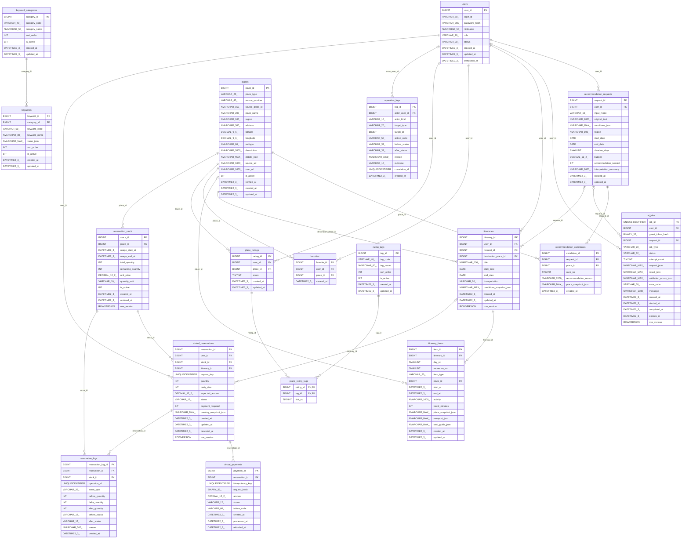

# 여행 추천 서비스 ERD

회원 닉네임은 `status <> 'WITHDRAWN'`인 행에만 UNIQUE를 적용한다. ERD 구조에는 조건부 인덱스가 표현되지 않으므로 `../sql/001_create_users.sql`을 함께 확인한다. 기존 Word·ERDCloud 저장본은 이 회원 구현 변경을 포함하지 않는다.

18개 테이블의 PK/FK 관계이다. CHECK·UNIQUE 및 서비스 검증 규칙은 [전체 정의서](../DB_테이블_정의서.md)를 따른다.

