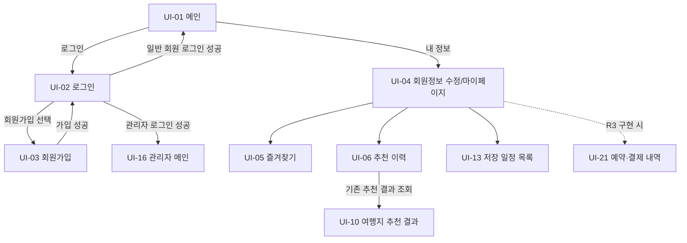
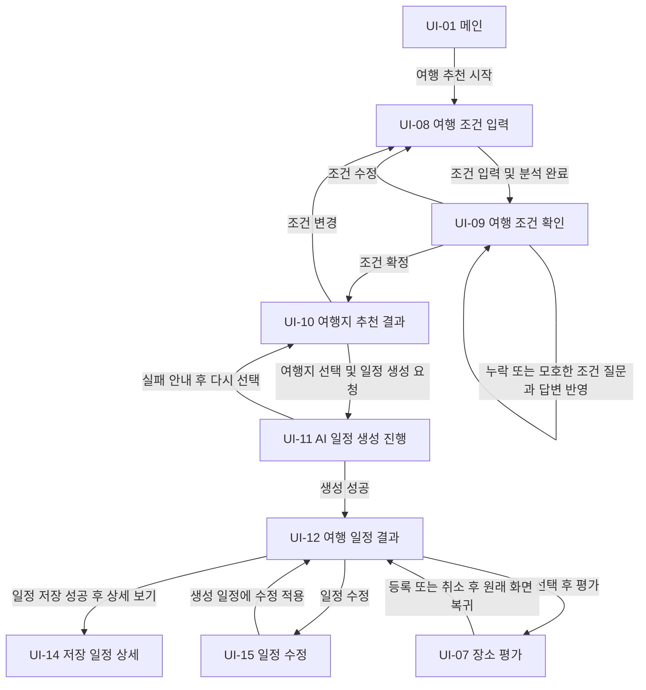
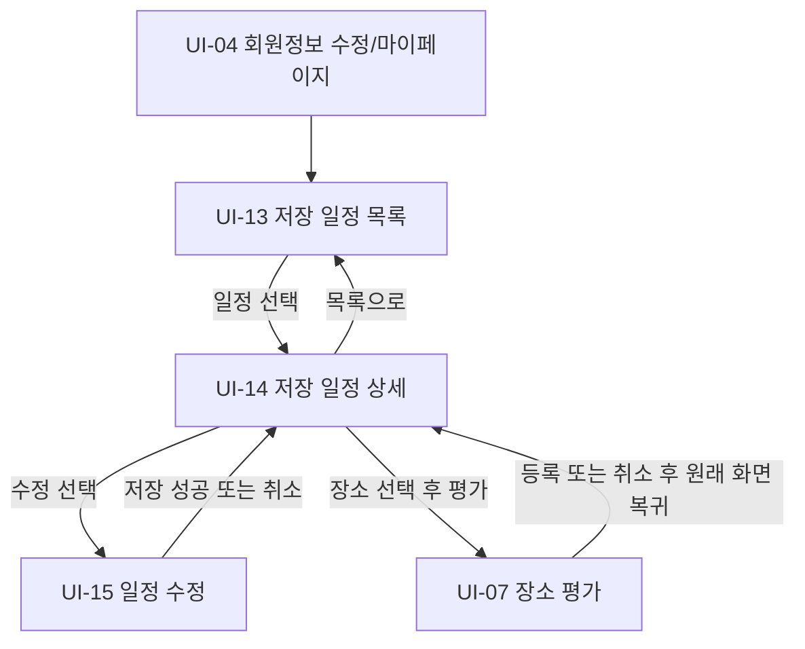
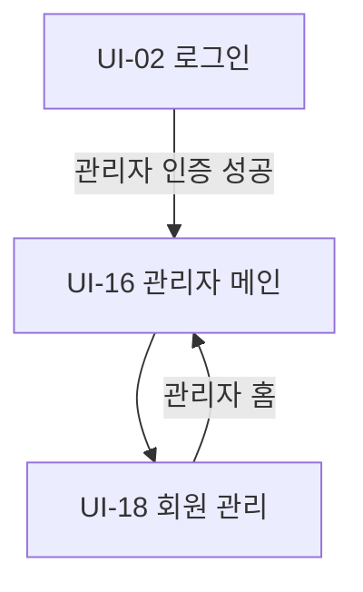
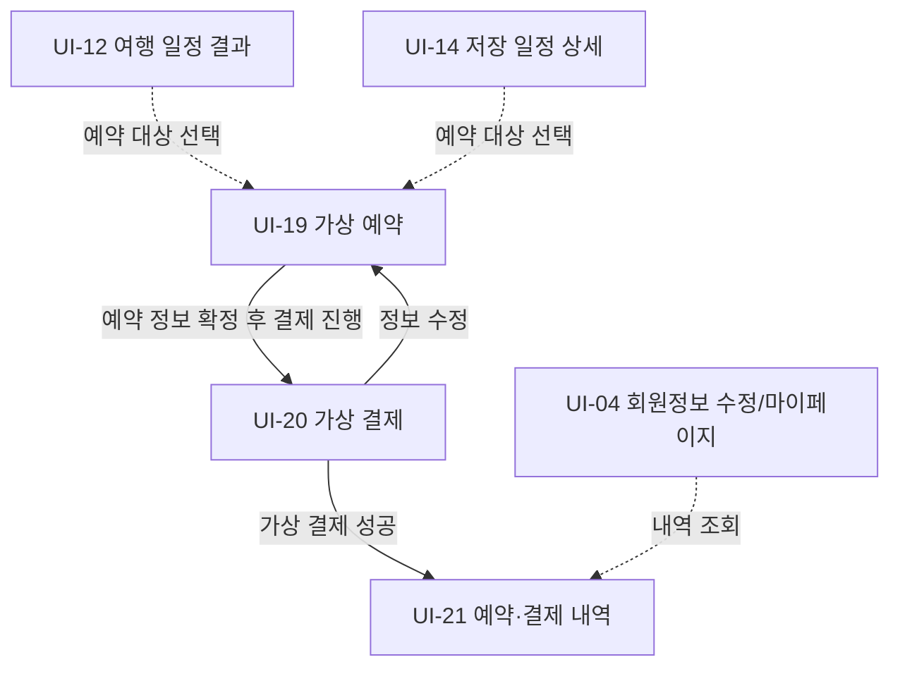

# 여행 추천 서비스 화면 흐름도

[요구분석서 적용 기준](../requirements/적용기준.md)과 화면 추적표를 따릅니다. UI-01~UI-21 중 UI-17을 제외한 20개 화면의 연결 설계이며 구현 완료 표시는 아닙니다. 비회원은 조건 입력·추천·일정 결과 조회가 가능하고 개인 저장·수정 기능은 로그인과 소유권 검증이 필요합니다. 기존 이미지는 참고용으로 보존합니다.

## 1. 공통·회원

- 회원가입 입력 오류나 로그인 실패는 해당 화면에서 안내하고 재입력합니다.
- 회원 기능에 비로그인 상태로 접근하면 UI-02로 이동하고, 로그인 성공 후 요청 화면으로 복귀하도록 설계합니다.
- 즐겨찾기 항목의 상세 정보는 카드·팝업으로 표시합니다. 별도 상세 화면 ID는 추가하지 않습니다.
- 회원정보 수정은 UI-04에서 저장 결과를 안내합니다. 회원 탈퇴는 확인 팝업 후 처리하고 메인으로 이동합니다.
- 로그아웃은 공통 메뉴에서 처리한 뒤 메인으로 이동합니다.

## 2. 추천·일정 생성

- 조건 분석 실패는 UI-08에서 안내하고, 추천 후보가 없으면 UI-10에서 조건 변경을 안내합니다.
- UI-11의 내부 처리 순서는 실제 장소 조회 → 서버 적합도 점수화·가까운 장소 날짜별 배치 → AI 세부 일정 생성 → 서버 시간·운영 검증입니다. 지도 정보가 없으면 확인 가능한 위치로 구성하고 이동시간 확인 필요를 안내합니다.
- 일정 생성 실패 시 UI-11에서 재시도하거나 UI-10으로 돌아갑니다. 기존 선택 조건을 유지합니다.
- UI-12의 저장 기능과 장소 평가 등 회원 기능에는 로그인 여부를 확인합니다.
- 즐겨찾기 등록, 장소 평가 요약, 지도 길찾기, 주변 지역 추천, 음식점 상세는 해당 화면의 버튼·영역·팝업으로 처리합니다.

## 3. 저장 일정 조회·수정

- UI-15는 UI-12와 UI-14에서 공통으로 사용합니다. 생성 중인 일정인지 저장된 일정인지 구분하고 진입 화면으로 복귀합니다.
- 수정 저장 실패 시 입력 내용을 유지하며 같은 화면에서 재시도합니다.
- UI-15는 직접 편집과 자연어 AI 수정 요청을 제공합니다. 현재 일정·조건·이번 요청을 기준으로 수정안을 생성하고 서버가 검증합니다. 수정 대상이 모호하면 해당 내용만 확인합니다.
- AI 처리 중 상태를 표시하고 검증된 수정안과 연관된 시간 변경을 보여줍니다. 사용자가 적용·저장하면 반영하고 취소·실패 시 원본을 유지합니다. 반복 요청은 최근 적용된 일정 기준이며 오래된 결과는 적용하지 않습니다.
- 조건 보완은 UI-09 안에서 필요한 항목만 질문하고 답변 또는 선택 버튼으로 채웁니다. 이미 확인한 조건은 유지하고 선택 조건의 답변은 강요하지 않습니다. 과거 대화 전체 기억과 이전 일정 버전 복원은 현재 범위에서 제외합니다.
- UI-07 역시 평가할 장소와 진입 화면을 전달받아 등록·취소 후 해당 화면으로 복귀합니다.
- 저장 일정이 없으면 UI-13에서 UI-08로 이동하는 추천 시작 버튼을 제공합니다.

## 4. 관리자

- 관리자 권한 확인은 모든 관리자 화면에 적용합니다. 일반 회원에게는 관리자 접근을 허용하지 않습니다.
- UI-17 키워드 관리 화면은 제외합니다. 사용자 선택지 데이터는 시스템 초기 데이터와 배포 SQL로 관리합니다.
- 회원 상태 변경은 UI-18 안의 상세 팝업에서 처리합니다. 관리자에 의한 회원 탈퇴·삭제는 포함하지 않습니다.
- 여행지·숙소·음식 정보 관리 및 별도 R3 관리자 운영 화면은 이번 흐름도에 포함하지 않습니다.

## 5. R3 확장: 가상 예약·결제

- 점선은 R3 구현 시에만 제공하는 진입 경로입니다. 전체 R3 영역은 선택적 확장입니다.
- 실제 예약 확정이나 실제 금전 결제를 수행하는 흐름이 아닙니다.
- 결제 실패는 UI-20에서 안내하고 재시도합니다. 가상 예약·결제 상태는 UI-21에서 조회합니다.
- UI-19에서 취소하면 진입한 UI-12 또는 UI-14로 돌아갑니다. 예약·결제의 상태 저장 시점은 DB 및 기능 설계에서 구체화합니다.

## 적용 메모

- 기존 번호 21개 중 UI-17을 제외한 20개를 사용하며 새 화면 ID를 추가하지 않았습니다.
- 회원가입 화면 이미지는 별도로 수정해야 합니다. 이번 작업은 화면 연결 설계입니다.
- 요구사항 연결은 [화면 추적표](화면_요구사항_추적표.md)를 확인합니다. 다음 구현은 여행지 선택과 실제 장소 후보 조회·기본 일정 배치입니다.
