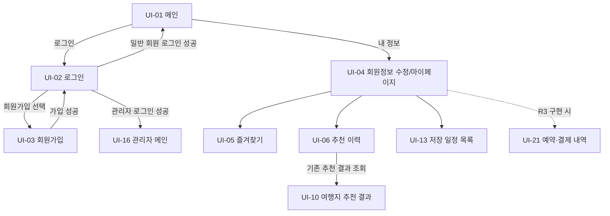
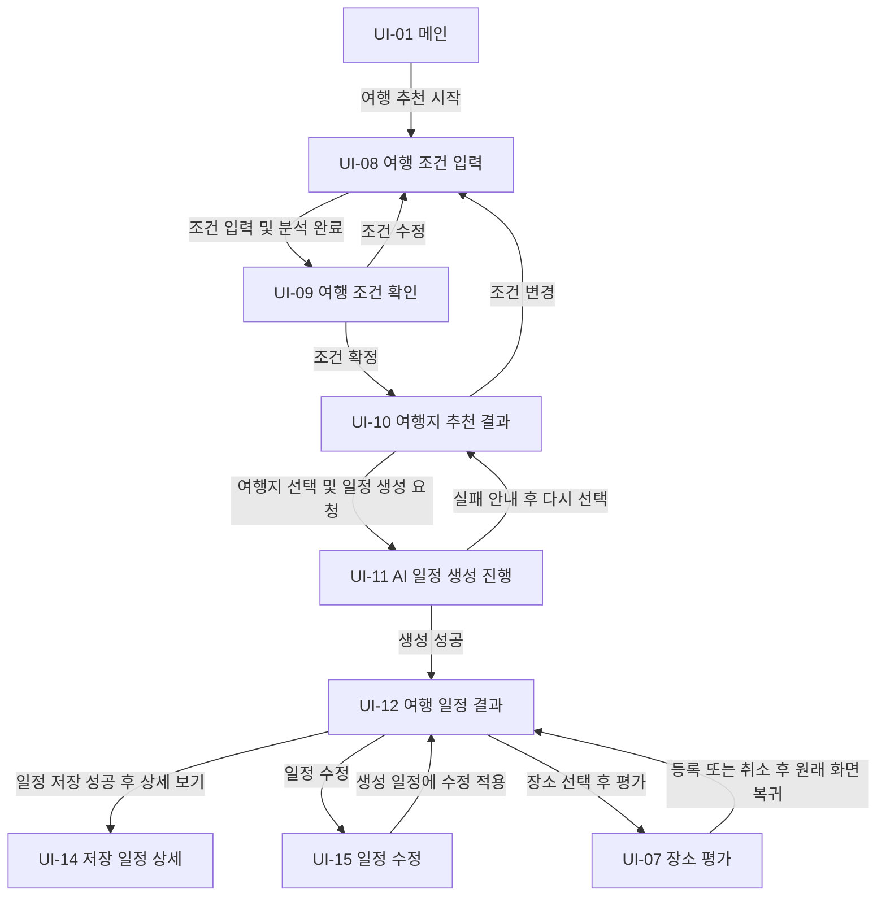
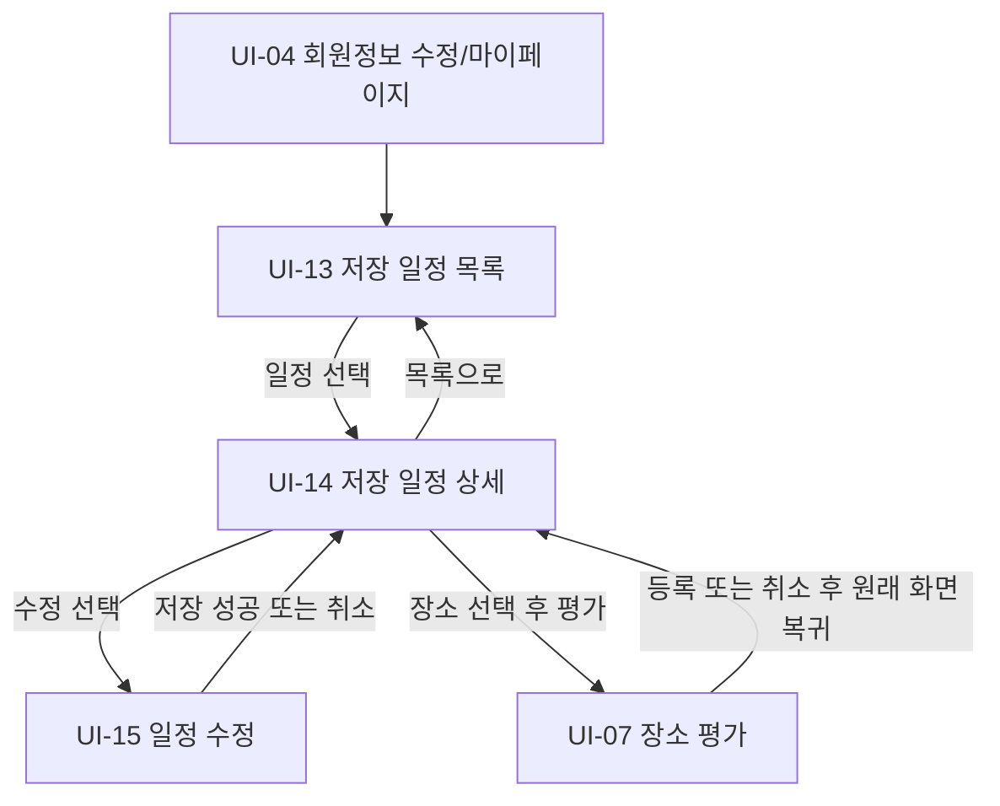
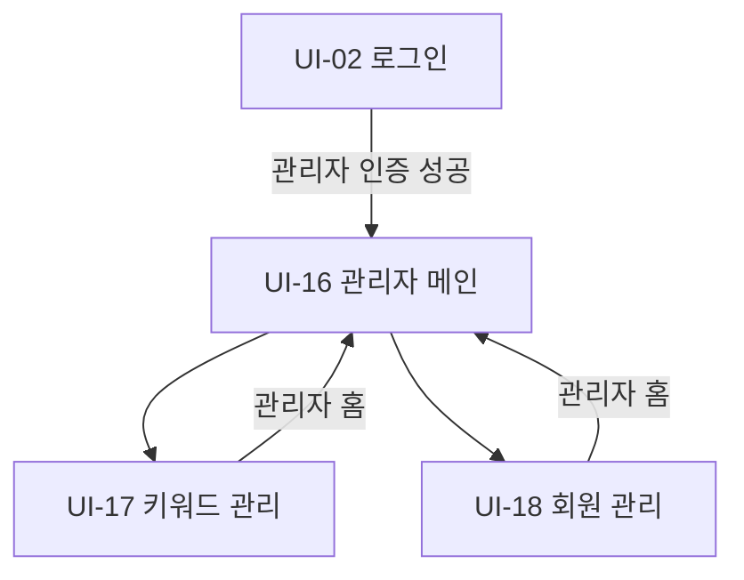
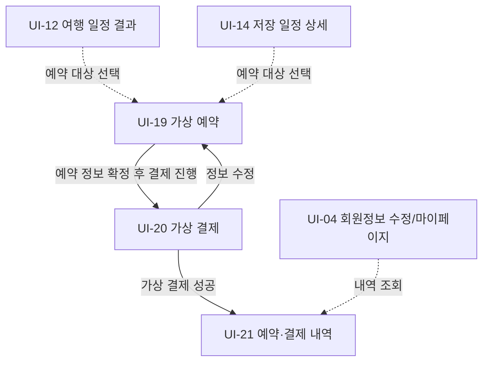

# 여행 추천 서비스 화면 흐름도

최종 화면 ID(UI-01~UI-21)를 기준으로 정리한 화면 연결 설계안입니다. 기존 이미지에는 변경이 없습니다. 아래의 복귀 경로, 로그인 후 이동, 오류 처리는 구현을 위한 제안이며, 비회원 이용 범위는 요구사항 추적표 작성 시 확정합니다.

> 2026-10-11 메모: 이 흐름도는 설계 당시 기준이다. UI-17 키워드 관리는 구현 범위에서 제외했다가 2026-10-28 다시 포함해 구현했고(UI-16 → UI-17 연결 그대로), 가상 예약·결제(UI-19~21)는 정식 기능이라 "R3 구현 시" 조건이 없다. UI-11은 여행 정보·장소 목록·하루 시간 입력 화면으로, UI-20은 예약 상세(UI-21) 안의 결제 영역으로 구현했다. 실제 화면·경로는 [화면–요구사항 추적표](화면_요구사항_추적표.md) 2절을 따른다.

## 1. 공통·회원

- 회원가입 입력 오류나 로그인 실패는 해당 화면에서 안내하고 재입력합니다.
- 회원 기능에 비로그인 상태로 접근하면 UI-02로 이동하고, 로그인 성공 후 요청 화면으로 복귀하도록 설계합니다.
- 즐겨찾기 항목의 상세 정보는 카드·팝업으로 표시합니다. 별도 상세 화면 ID는 추가하지 않습니다.
- 회원정보 수정은 UI-04에서 저장 결과를 안내합니다. 회원 탈퇴는 확인 팝업 후 처리하고 메인으로 이동합니다.
- 로그아웃은 공통 메뉴에서 처리한 뒤 메인으로 이동합니다.

## 2. 추천·일정 생성

- 조건 분석 실패는 UI-08에서 안내하고, 추천 후보가 없으면 UI-10에서 조건 변경을 안내합니다.
- 일정 생성 실패 시 UI-11에서 재시도하거나 UI-10으로 돌아갑니다. 기존 선택 조건을 유지합니다.
- UI-12의 저장 기능과 장소 평가 등 회원 기능에는 로그인 여부를 확인합니다.
- 즐겨찾기 등록, 장소 평가 요약, 지도 길찾기, 주변 지역 추천, 음식점 상세는 해당 화면의 버튼·영역·팝업으로 처리합니다.

## 3. 저장 일정 조회·수정

- UI-15는 UI-12와 UI-14에서 공통으로 사용합니다. 생성 중인 일정인지 저장된 일정인지 구분하고 진입 화면으로 복귀합니다.
- 수정 저장 실패 시 입력 내용을 유지하며 같은 화면에서 재시도합니다.
- UI-07 역시 평가할 장소와 진입 화면을 전달받아 등록·취소 후 해당 화면으로 복귀합니다.
- 저장 일정이 없으면 UI-13에서 UI-08로 이동하는 추천 시작 버튼을 제공합니다.

## 4. 관리자

- 관리자 권한 확인은 모든 관리자 화면에 적용합니다. 일반 회원에게는 관리자 접근을 허용하지 않습니다.
- 키워드 추가·수정·삭제는 UI-17 안에서 처리합니다.
- 회원 상태 변경은 UI-18 안의 상세 팝업에서 처리합니다. 관리자에 의한 회원 탈퇴·삭제는 포함하지 않습니다.
- 여행지·숙소·음식 정보 관리 및 별도 R3 관리자 운영 화면은 이번 흐름도에 포함하지 않습니다.

## 5. R3 확장: 가상 예약·결제

- 점선은 R3 구현 시에만 제공하는 진입 경로입니다. 전체 R3 영역은 선택적 확장입니다.
- 실제 예약 확정이나 실제 금전 결제를 수행하는 흐름이 아닙니다.
- 결제 실패는 UI-20에서 안내하고 재시도합니다. 가상 예약·결제 상태는 UI-21에서 조회합니다.
- UI-19에서 취소하면 진입한 UI-12 또는 UI-14로 돌아갑니다. 예약·결제의 상태 저장 시점은 DB 및 기능 설계에서 구체화합니다.

## 적용 메모

- 전체 흐름도에는 기존 21개 화면을 모두 포함하며 새 화면 ID를 추가하지 않았습니다.
- 회원가입 화면 이미지는 별도로 수정해야 합니다. 이번 작업은 화면 연결 설계입니다.
- 다음 단계는 요구분석서의 기능별 요구사항 ID를 위 화면·버튼·팝업에 연결하는 화면–요구사항 추적표 작성입니다.
